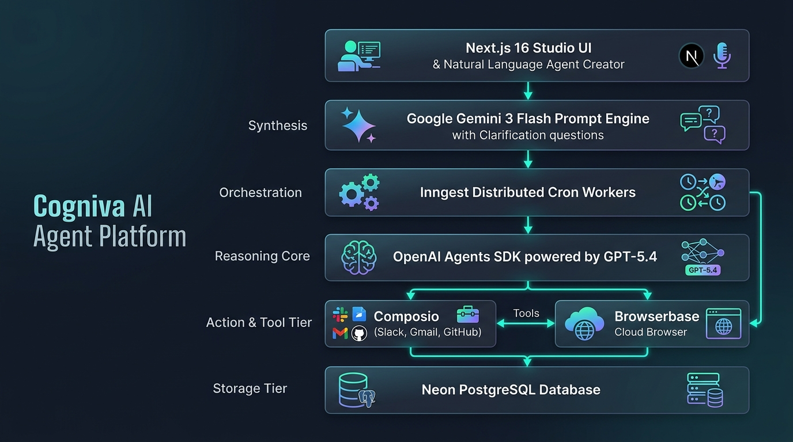

# Cogniva 🧠⚡

> **Autonomous Multi-Tool AI Agent Platform & Production Workflow Orchestrator**  
> *Cogniva keeps your agents moving while you work.*

---

## 📌 Overview

**Cogniva** is a full-stack, enterprise-grade AI agent orchestration platform that empowers users to synthesize, configure, schedule, and monitor autonomous AI agents using natural language. 

By unifying **Google Gemini models** for intelligent agent synthesis, **OpenAI Agent SDK** (powered by **GPT-5.4**) for autonomous execution reasoning, **Composio** for authenticated SaaS tool connections (Gmail, Slack, GitHub, HubSpot, PostgreSQL, etc.), **Browserbase** for headless cloud browser automation, and **Inngest** for background scheduling and cron orchestration, Cogniva bridges the gap between conversational AI and real-world operations.

---

## 🌟 Key Features

### 1. 🗣️ Prompt-to-Agent Synthesis with Intelligent Clarification
- Describe workflows in plain English (e.g., *"Every weekday at 8 AM, scan my unread emails in Gmail, flag urgent invoices, and draft reply suggestions"*).
- Powered by Google Gemini ( gemini-3.6-flash with thinking level control and multi-model fallback).
- Detects ambiguities and interactively prompts the user with dynamic multi-choice and text clarification questions before provisioning.

### 2. 🔌 Unified Tool Ecosystem (Composio + Browserbase)
- **Composio Integration**: Seamless OAuth-based tool authorization allowing agents to read and mutate external applications.
- **Browserbase Stealth Automation**: Autonomous web browsing, live document extraction, competitive intelligence gathering, and scraping.
- **Custom Native Tools**: Web search, calculation, and database queries.

### 3. ⏱️ Distributed Scheduling & Background Workers (Inngest)
- Recurring (hourly, daily, weekly, monthly) and on-demand execution cadences.
- Timezone-aware cron scheduling evaluated across distributed Inngest worker pipelines.
- Distributed locking and atomic run claiming to prevent duplicate execution during overlapping cron intervals.
- Automatic calculation of next scheduled execution timestamps upon run completion.

### 4. 💬 Interactive Chat & Testing Drawer
- Chat directly with any deployed agent in real-time.
- Supports streaming markdown, GFM tables, code highlighting, and sandboxed live HTML email/report previews.

### 5. 📊 Real-Time Telemetry & Audit Trail
- Comprehensive audit ledger logging every execution step, reasoning payload, intermediate tool outputs, duration, and errors.
- Visual status indicators (`scheduled`, `running`, `completed`, `failed`).

### 6. 🎨 Clean, High-Contrast SaaS UI
- Built with Next.js 16 App Router, React 19, and Tailwind CSS v4.
- High-contrast aesthetic with obsidian dark pills, crisp slate borders, soft ambient glows, and responsive layout.

---

## 🏗️ System Architecture & Workflow

<p align="center">
  
</p>

---

## 🛠️ Tech Stack

| Domain | Technologies |
| :--- | :--- |
| **Frontend & Framework** | [Next.js 16](https://nextjs.org/) (App Router), [React 19](https://react.dev/), [TypeScript](https://www.typescriptlang.org/) |
| **Styling & Components** | [Tailwind CSS v4](https://tailwindcss.com/), [Shadcn UI](https://ui.shadcn.com/), Lucide Icons |
| **Authentication** | [Clerk](https://clerk.com/) |
| **Database & ORM** | [Neon Serverless PostgreSQL](https://neon.tech/), [Drizzle ORM](https://orm.drizzle.team/), Drizzle Kit |
| **Workflow & Job Queue** | [Inngest](https://www.inngest.com/) (Distributed Cron & Event-Driven Workers) |
| **AI Synthesis** | [@google/genai](https://www.npmjs.com/package/@google/genai) (`gemini-3.6-flash`, `gemini-3.5-flash`) |
| **AI Execution Engine** | [@openai/agents](https://www.npmjs.com/package/@openai/agents), `@composio/openai-agents` (Powered by `gpt-5.4`) |
| **Tool Integrations** | [Composio Core](https://composio.dev/), [@browserbasehq/sdk](https://www.browserbase.com/) |
| **Markdown & Formatting** | `react-markdown`, `remark-gfm`, `date-fns`, `date-fns-tz` |

---

## 📁 Repository Structure

```text
cogniva/
├── app/
│   ├── api/
│   │   ├── agent/
│   │   │   ├── configure/       # Agent synthesis & clarification route (Gemini)
│   │   │   ├── log/             # Execution log retrieval
│   │   │   ├── run/             # On-demand agent run trigger
│   │   │   └── tools/           # Agent tool provisioning & connections
│   │   ├── inngest/             # Inngest webhook route endpoint
│   │   ├── integrations/        # Composio tool listings & OAuth redirects
│   │   └── users/               # User sync & credit balance management
│   ├── dashboard/
│   │   ├── agents/              # Agent management & creation tabs
│   │   ├── integrations/        # Connected tools directory & OAuth connections
│   │   ├── profile/             # User identity & Clerk security
│   │   ├── run/                 # Execution history & live telemetry
│   │   ├── settings/            # Timezone preferences & workspace settings
│   │   ├── templates/           # Pre-built agent template library
│   │   ├── layout.tsx           # Dashboard shell with AppSidebar
│   │   └── page.tsx             # Overview metrics & activity timeline
│   ├── globals.css              # Design tokens & modern styling system
│   ├── layout.tsx               # Root layout with ClerkProvider & Contexts
│   └── page.tsx                 # Landing page
├── components/
│   ├── brand/                   # Brand logo & iconography
│   ├── custom/
│   │   ├── agents/              # CreateAgent, MyAgents, ChatDrawer, EditSheet
│   │   ├── dashboard/           # AppSidebar & workspace switchers
│   │   └── run/                 # Stats cards, RecentRuns table, RunDetailsDialog
│   ├── landing/                 # Hero, Features, Showcase, Pricing, FAQ, Footer
│   └── ui/                      # Base UI primitives (buttons, dialogs, sheets, toast)
├── db/
│   ├── index.ts                 # Neon Postgres connection client
│   └── schema.ts                # Drizzle ORM schema definitions
├── inngest/
│   ├── client.ts                # Inngest client initialization
│   └── functions.ts             # Scheduled agent runner & worker pipelines
├── lib/
│   ├── agent-schedule.ts        # Timezone & cadence calculation logic
│   ├── browserbase-tool.ts      # Browserbase cloud browser tool wrapper
│   ├── build-agent.ts           # OpenAI Agent builder with Composio tools
│   ├── composio.ts              # Composio SDK client
│   ├── execute-agent.ts         # Agent execution engine
│   └── get-agent-composio-session.ts # Session manager & tool filtering
├── data/                        # Agent starter templates & presets
├── public/                      # Static assets & illustrations
├── drizzle.config.ts            # Drizzle Kit configuration
└── package.json                 # Project dependencies & scripts
```

---

## ⚙️ Environment Variables

Create a `.env` file in the root directory and configure the following variables:

```env
# Application URL
NEXT_PUBLIC_APP_URL=

# Neon Serverless Postgres Database (Drizzle ORM)
DATABASE_URL=
# Clerk Authentication
NEXT_PUBLIC_CLERK_PUBLISHABLE_KEY=
CLERK_SECRET_KEY=
NEXT_PUBLIC_CLERK_SIGN_IN_URL=/sign-in
NEXT_PUBLIC_CLERK_SIGN_UP_URL=/sign-up

# Google Cloud Gemini API (Agent Synthesis & Clarification)
GOOGLE_CLOUD_GEMINI_API_KEY=

# OpenAI API Key (Agent Execution Engine)
OPENAI_API_KEY=
OPENAI_MODEL=

# Composio API (Third-Party SaaS Integrations)
COMPOSIO_API_KEY=

# Browserbase (Headless Browser Automation)
BROWSERBASE_API_KEY=
BROWSERBASE_AGENT_ID=

# Inngest (Background Jobs & Scheduling)
INNGEST_DEV=1
```

---

## 🚀 Getting Started

### 1. Prerequisites
- **Node.js**: `v20.x` or later
- **npm** or **pnpm**
- A **Neon PostgreSQL** database instance
- A **Clerk** application for authentication

### 2. Installation
Clone the repository and install project dependencies:

```bash
git clone https://github.com/your-username/cogniva.git
cd cogniva
npm install
```

### 3. Database Migration
Push the Drizzle schema to your Neon database:

```bash
npm run db:push
```

To view and edit database records visually:
```bash
npm run db:studio
```

### 4. Running the Development Server
Start the Next.js local development server:

```bash
npm run dev
```
Open [http://localhost:3000](http://localhost:3000) in your browser.

### 5. Running Inngest Locally (For Scheduled Workflows)
To test and monitor background agent executions and cron triggers locally:

```bash
npx inngest-cli@latest dev -u http://localhost:3000/api/inngest
```
Open the Inngest Dev Server dashboard at [http://localhost:8288](http://localhost:8288).

---

## 🔄 Agent Lifecycle & Execution Flow

```text
1. Prompt Input ──► User enters request in Create Agent box.
2. Synthesis     ──► /api/agent/configure sends prompt to Gemini with thinkingConfig.
3. Clarification ──► If required parameters are missing, returns dynamic question list.
4. Provisioning  ──► Drizzle DB stores agentConfig with schedule, tools, and instructions.
5. Inngest Cron  ──► ProcessScheduledAgent polls due agent runs every 15 minutes.
6. Execution     ──► Worker builds OpenAI Agent powered by GPT-5.4 with Composio tools and Browserbase.
7. Result        ──► Output written to agentRun; next recurrence automatically scheduled.
```

---

## 🛡️ Security & Operational Guardrails

- **Encrypted Token Management**: Composio handles third-party OAuth access securely; credentials are never exposed to the frontend.
- **Human-in-the-Loop Controls**: Any agent can be paused, updated, or re-run on demand from the dashboard.
- **Execution Isolation**: Runs operate within isolated execution contexts with strict timeout limits and error boundary traps.
- **Database Safeguards**: Unique index constraints (`unique_agent_occurrence`) prevent duplicate executions for the same scheduled timestamp.

---

